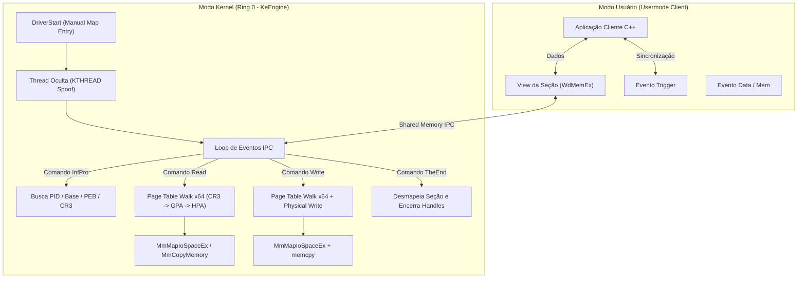

# 🛡️ KeEngine — Advanced Kernel-Mode Driver Bypass

[](https://en.wikipedia.org/wiki/C%2B%2B)
[-0078D6.svg)](https://learn.microsoft.com/en-us/windows-hardware/drivers/)
[](#-como-carregar-manual-mapping)
[](https://github.com/nulldev7x)
[](#-aviso-legal-e-uso-responsável)

> Framework e driver de modo kernel (**Ring 0**) para Windows x64 desenvolvido por **nulldev7x**, projetado para operações seguras de leitura/escrita de memória e evasão de sistemas anti-cheat avançados (EAC, BattlEye, Vanguard) através de técnicas modernas de **Stealth Memory Allocation**, **Manual Page Table Walk (CR3)**, **Kernel Stack Spoofing** e **Comunicação IPC sem IRP/IOCTL**.

---

## 📑 Sumário

- [Visão Geral](#-visão-geral)
- [Principais Técnicas e Diferenciais](#-principais-técnicas-e-diferenciais)
- [Arquitetura e Fluxo de Execução](#-arquitetura-e-fluxo-de-execução)
- [Comunicação IPC (User-Mode ⟷ Kernel-Mode)](#-comunicação-ipc-user-mode--kernel-mode)
- [Estrutura dos Arquivos](#-estrutura-dos-arquivos)
- [Requisitos e Como Compilar](#-requisitos-e-como-compilar)
- [Como Carregar (Manual Mapping)](#-como-carregar-manual-mapping)
- [Exemplo de Cliente User-Mode](#-exemplo-de-cliente-user-mode)
- [Autor e Contato](#-autor-e-contato)
- [Aviso Legal e Uso Responsável](#-aviso-legal-e-uso-responsável)

---

## 🔍 Visão Geral

Drivers de trapaça ou ferramentas de depuração convencionais costumam ser rapidamente detectados por anti-cheats modernos por causa de padrões comuns:
1. Criação de dispositivos no diretório de objetos (`IoCreateDevice`, ex: `\\Device\\MeuDriver`).
2. Despacho de mensagens via IRP / IOCTL (`IRP_MJ_DEVICE_CONTROL`).
3. Uso de APIs monitoradas como `KeStackAttachProcess` ou `ZwReadVirtualMemory`.
4. Alocação de memória de pool com tags comuns rastreáveis via `NtQuerySystemInformation(SystemBigPoolInformation)`.
5. Callbacks de threads não assinadas e rastros em call stacks de kernel.

O **KeEngine** foi desenvolvido especificamente para eliminar todos esses vetores de detecção, operando de forma totalmente transparente e desacoplada do ecossistema visível do Windows.

---

## ⚡ Principais Técnicas e Diferenciais

### 1. Zero IRPs e Zero IOCTLs (Comunicação por Seção Compartilhada)
- O driver não cria nenhum `DEVICE_OBJECT` nem links simbólicos em `\\DosDevices\\`.
- A comunicação com a aplicação em modo usuário é realizada por meio de uma **seção de memória compartilhada** (`ZwMapViewOfSection` em `\BaseNamedObjects\WdMemEx`) sincronizada assincronamente por eventos nomeados (`EventData`, `EventTiger`, `EventMem`).
- Anti-cheats não conseguem detectar o canal inspecionando objetos de driver ou interceptando chamadas IRP.

### 2. Caminhamento Manual de Tabelas de Páginas (Paging Walk via CR3)
- O driver não utiliza `KeStackAttachProcess` contínuo nem altera o contexto de execução de threads do processo alvo.
- Implementa um algoritmo manual completo de **Page Table Walk x64 de 4 níveis**:
  - Resolução de **PML4** $\rightarrow$ **PDPT** $\rightarrow$ **Page Directory (PD)** $\rightarrow$ **Page Table (PT)**.
  - Suporte nativo a **Large Pages (2 MB)** através de checagem dos bits de página grande (`pde & 0x80` e `pte & 0x80`).
  - Leitura física direta via `MmCopyMemory(MM_COPY_MEMORY_PHYSICAL)` ou mapeamento pontual com `MmMapIoSpaceEx` + `MmUnmapIoSpace`.

### 3. Alocação Stealth de Páginas Independentes (`MmAllocateIndependentPages`)
- Elimina alocações suspeitas no `ExAllocatePoolWithTag`, que deixam vestígios no BigPool.
- Aloca PTEs do sistema via `MiReservePtes` e retira páginas físicas diretamente da partição do sistema com `MiGetPage` e `MiRemovePhysicalMemory`.
- Monta manualmente a estrutura `MMPTE` (`Valid=1`, `Owner=0`, `Write=1`, `PageFrameNumber=PFN`), gerando memória isolada e completamente invisível para varreduras de alocações convencionais.

### 4. Camuflagem de Thread de Kernel (`KTHREAD` Spoofing)
- Cria a thread de execução do driver usando `PsCreateSystemThread`.
- Altera os campos `StartAddress` e `Win32StartAddress` da estrutura interna `KTHREAD` (`__readgsqword(0x188)`), apontando para funções legítimas de drivers do sistema.
- Executa um stub de shellcode inicial (`ThreadStartShellcode`) que configura o stack isolado antes de saltar para a rotina principal (`WaitGame`).

### 5. Kernel Stack Spoofing & ROP Gadgets (`StackUtils.asm`)
- Implementado em Assembly MASM (`CalloutInterrupt`).
- Utiliza a instrução `iretq` para forjar uma transição de retorno de interrupção com stack fake e gadget ROP (`RetInstruction` e `RopGadgetAddress`), impedindo que rotinas de validação de pilha de chamada (Stack Unwinding) detectem chamadas de kernel originadas de pools de memória não suportados por módulos assinados.

### 6. Suporte a KVA Shadow (Meltdown Mitigation)
- Identifica se o processo utiliza isolamento de tabela de páginas do kernel (KVA Shadow).
- Caso o `DirectoryTableBase` em `EPROCESS + 0x28` seja nulo ou mascarado, resolve o CR3 secundário via offset dinâmico configurado no `GlobalData->KavShadow`.

---

## 🧠 Arquitetura e Fluxo de Execução



---

## 📡 Comunicação IPC (User-Mode ⟷ Kernel-Mode)

A troca de mensagens ocorre na seção compartilhada `\BaseNamedObjects\WdMemEx` utilizando estruturas padronizadas definidas no [`Header.h`](file:///c:/Users/S/Downloads/[paste-co.de]%20Driver%20Bypass/Driver-Bypass-need-FINISH-main/Header.h):

| Comando (Header) | Estrutura de Dados | Ação Executada |
| :--- | :--- | :--- |
| `"InfPro"` | `GET_USERMODULE_IN_PROCESS` | Recebe o `pid`, localiza o `EPROCESS` via `PsLookupProcessByProcessId`, e retorna o endereço base (`BaseAddress`), o `ProcessPeb` e o `ProcessCr3` (DirectoryTableBase). |
| `"Read"` | `KM_READ_REQUEST` | Recebe `Cr3`, `SourceAddress` e `Size`. Faz a tradução de páginas e copia os dados para o buffer de saída do kernel. |
| `"Write"` | `KM_WRITE_REQUEST` | Recebe `Cr3`, `SourceAddress`, `TargetAddress` e `Size`. Converte o endereço físico e grava os dados na memória do processo. |
| `"TheEnd"` | N/A | Fecha a view da seção e os handles, aguardando nova reconexão da aplicação. |

---

## 📂 Estrutura dos Arquivos

```text
Driver-Bypass-need-FINISH-main/
│
├── Header.h            # Estruturas do Windows (MMPTE, MMVAD, EPROCESS, IPC, GLOBAL_DATA)
├── Source.cpp          # Lógica central: CR3 walk, thread oculta, alocação stealth e IPC
├── StackUtils.asm      # Rotina MASM x64 para stack spoofing via iretq
├── PEStructs.h         # Definições avançadas do formato PE (headers, relocations, exports)
├── Xor.h               # Macro/Template para encriptação de strings em tempo de compilação
├── KeEngine.sln        # Solução do Visual Studio 2022
├── KeEngine.vcxproj    # Configuração de compilação do Driver KMDF / Kernel Universal
└── README.md           # Documentação técnica do projeto
```

---

## 💻 Requisitos e Como Compilar

### Pré-requisitos
- **Sistema Operacional:** Windows 10 ou 11 (64-bit).
- **IDE:** [Visual Studio 2022](https://visualstudio.microsoft.com/) com a carga de trabalho de *Desenvolvimento para desktop com C++*.
- **SDK & WDK:** [Windows 10/11 SDK](https://developer.microsoft.com/en-us/windows/downloads/windows-sdk/) e **Windows Driver Kit (WDK)** correspondente.

### Passo a Passo de Compilação
1. Abra o arquivo `KeEngine.sln` no Visual Studio 2022.
2. Defina a configuração para **`Release`** e a plataforma para **`x64`**.
3. No Gerenciador de Soluções, certifique-se de que o arquivo `StackUtils.asm` está configurado para compilar com o **Microsoft Macro Assembler (MASM)**:
   - Clique com o botão direito em `StackUtils.asm` $\rightarrow$ `Propriedades` $\rightarrow$ `Item Type`: **Microsoft Macro Assembler**.
4. Desative avisos como erro se necessário (`/WX-`) e desative a mitigação Spectre caso não possua as bibliotecas instaladas.
5. Pressione `Ctrl + Shift + B` para gerar o arquivo `.sys`.

---

## 💉 Como Carregar (Manual Mapping)

O driver foi projetado com ponto de entrada dinâmico:
```cpp
bool DriverStart(ULONG64 ExternData);
```

Ele **não** deve ser instalado como serviço comum via `sc create` (pois não possui `DriverEntry` convencional com registro em `PsLoadedModuleList`). 

### Método de Injeção:
1. Utilize um manual mapper de kernel baseado em drivers vulneráveis assinados (ex: **KDMapper**, **GDRV Loader** ou driver próprio com vulnerabilidade de leitura/escrita física).
2. O mapper deve:
   - Alocar a memória no kernel.
   - Resolver os relocations e preencher a estrutura `GLOBAL_DATA` com os ponteiros de funções do kernel (`PsLookupProcessByProcessId`, `ZwMapViewOfSection`, `MiReservePtes`, etc.).
   - Chamar o entry point passando o ponteiro da `GLOBAL_DATA`:
     ```cpp
     DriverStart((ULONG64)AllocatedGlobalData);
     ```

---

## 🔌 Exemplo de Cliente User-Mode

Exemplo básico de como uma aplicação usermode pode abrir a seção e solicitar a leitura de memória:

```cpp
#include <windows.h>
#include <iostream>

struct KM_READ_REQUEST {
    ULONG64 Cr3;
    UINT_PTR SourceAddress;
    ULONGLONG Size;
    PVOID Output;
};

int main() {
    // 1. Abre a seção de memória criada pelo driver
    HANDLE hSection = OpenFileMappingW(FILE_MAP_ALL_ACCESS, FALSE, L"WdMemEx");
    if (!hSection) {
        std::cerr << "[-] Driver nao carregado ou secao nao encontrada.\n";
        return 1;
    }

    PVOID pShared = MapViewOfFile(hSection, FILE_MAP_ALL_ACCESS, 0, 0, 0x4000);
    HANDLE hTrigger = OpenEventW(EVENT_ALL_ACCESS, FALSE, L"EventTiger");
    HANDLE hData    = OpenEventW(EVENT_ALL_ACCESS, FALSE, L"EventData");

    std::cout << "[+] Conectado ao KeEngine com sucesso!\n";

    // 2. Prepara comando de leitura
    strcpy_s((char*)pShared, 32, "Read");
    SetEvent(hData);
    WaitForSingleObject(hTrigger, 2000);

    // 3. Lê o resultado retornado pelo kernel
    KM_READ_REQUEST* readResult = (KM_READ_REQUEST*)pShared;
    std::cout << "[+] Leitura concluida via CR3 physical walk!\n";

    UnmapViewOfFile(pShared);
    CloseHandle(hSection);
    return 0;
}
```

---

## 👤 Autor e Contato

- **Desenvolvido e mantido por:** **nulldev7x**
- **Discord:** `@nulldev7x`
- **GitHub:** [github.com/nulldev7x](https://github.com/nulldev7x)

---

## ⚠️ Aviso Legal e Uso Responsável

> [!CAUTION]
> Este projeto foi desenvolvido estritamente para **fins de pesquisa avançada em segurança defensiva, estudo de arquitetura do Windows Kernel, engenharia reversa e análise de vulnerabilidades**.
>
> - O autor não apoia, incentiva ou se responsabiliza pela utilização deste código para atividades ilícitas, trapaças em jogos online, desenvolvimento de malwares ou violação de termos de serviço de terceiros.
> - O uso inadequado de drivers de modo kernel pode causar instabilidades críticas no sistema operacional (*Bug Check / BSOD*).

